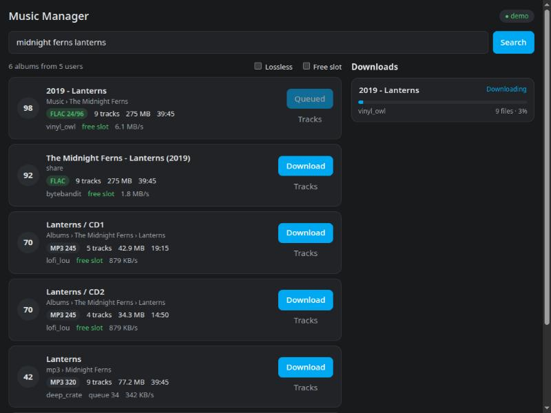

# HA Music Manager

Search and download music from the [Soulseek](https://www.slsknet.org/) network without leaving
Home Assistant. It runs as a Home Assistant app with its own panel in the sidebar.




Soulseek search results come back as thousands of loose files. HA Music Manager turns them
into **albums**: it groups each peer's files by folder, shows the format and bitrate at a
glance, and ranks the candidates by quality and by how likely they are to download quickly.
One click queues the whole album into your media folder. From there Music Assistant, Jellyfin
or Plex can pick it up.

> **Status:** early development (0.x). Phase 1 (search, album grouping, downloads) works.
> See the [roadmap](#roadmap).

## Features

- **Album-first search.** Results are grouped per peer and folder, with multi-disc folders
  (`CD1`, `Disc 2`) labelled after their parent.
- **Quality at a glance.** You see labels like `FLAC 24/96`, `FLAC` or `MP3 320`, plus a
  0–100 score that weighs quality against the peer's free slots, queue length and upload speed.
- **One-click downloads** into `/media/music`, with live progress per album and per track.
- **Native feel.** It lives in the Home Assistant sidebar through Ingress, follows your
  light/dark theme and works in the companion app.
- **Secure by default.** The Soulseek engine's API only listens on loopback behind a random API
  key, and the web UI only answers Home Assistant's Ingress gateway.

## Installation

1. In Home Assistant, go to **Settings → Apps → App store → ⋮ → Repositories** and add
   `https://github.com/jmanera/ha-music-manager`.
2. Install **Music Manager**, then set your Soulseek username and password under
   **Configuration**. A new account is created on first login if the name is free.
3. Start the app and open **Music** in the sidebar.

See [`music_manager/DOCS.md`](music_manager/DOCS.md) for all options.

## How it works

```
 Home Assistant sidebar
          │  Ingress (172.30.32.2 → :8099)
          ▼
 ┌──────────── app container ───────────────────────────────┐
 │  FastAPI backend ── serves the Svelte UI                 │
 │     │  groups files into albums, scores them             │
 │     │  supervises ▼ (restarts on crash)                  │
 │     └─ HTTP + API key ─▶ slskd  127.0.0.1:5030 ──────────┼─▶ Soulseek network (:50300)
 │                            │                             │
 │                            └─▶ /media/music              │
 └──────────────────────────────────────────────────────────┘
```

- **[slskd](https://github.com/slskd/slskd)** is the Soulseek engine. The backend writes its
  config, runs it as a child process and talks to its REST API.
- **The backend** (`src/ha_music_manager`) is Python 3.13 with FastAPI, httpx and Pydantic,
  type-checked with `mypy --strict`.
- **The frontend** (`frontend/`) is Svelte 5, TypeScript and Vite. It is built into static files
  and served by the backend. Every URL is relative, so it works behind Ingress' dynamic prefix.

## Development

You need [uv](https://docs.astral.sh/uv/), Node 20+ and Docker (optional).

```bash
make install        # Python + npm dependencies, pre-commit hooks
make check          # lint, types, tests (Python + frontend), security audit
make demo           # whole app on http://localhost:8099 with a fake slskd and canned results
make dev            # backend on :8099 against an slskd you run yourself (see Makefile)
make image          # build the app image locally
```

All tests run **locally** (`make check` and pre-commit), not in CI. GitHub Actions only builds
and publishes the multi-arch images on a version tag.

## Roadmap

- [x] **Phase 1.** slskd engine, album-oriented search, quality scoring, downloads with progress
- [ ] **Phase 2.** MusicBrainz matching (tracklist completeness, cover art), auto-tagging,
      `Artist/Album` folder layout, a wishlist that retries missing albums
- [ ] **Phase 3.** Home Assistant integration: sensors (active downloads, speed), a
      `music_manager.search_and_download` action, notifications when an album finishes

## Legal

HA Music Manager is a client for a peer-to-peer network. Download and share only content you
have the right to. The authors do not condone copyright infringement.

## License

[MIT](LICENSE) © Juan Manera
